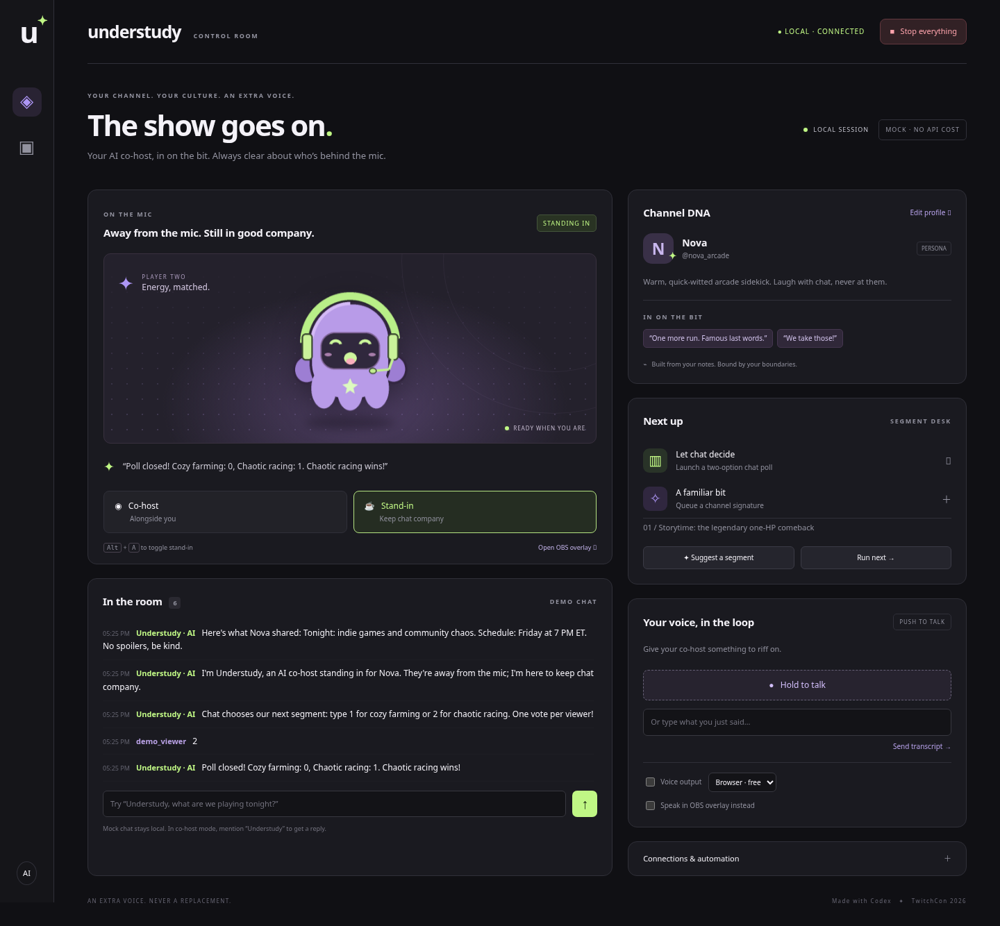
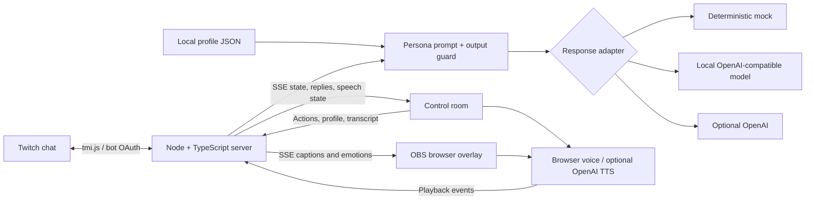

# Understudy ✦

**Your channel. Your culture. An extra voice.**

Understudy is an openly AI co-host for Twitch streamers. It uses a streamer-authored channel profile to join in on familiar bits, answer stream questions, and keep chat company during a break. The human stays in control. Understudy always has its own identity.

Small streamers juggle gameplay, conversation, and moderation. A bathroom break should not mean an empty room, and a co-host should understand the community's jokes. Understudy makes that channel context portable between live co-hosting and an explicitly disclosed stand-in mode.



## Run locally

Requires **Node.js 22+** and npm. From this checkout:

```sh
npm i && npm run dev
```

Open **http://127.0.0.1:3000**. No credentials, database, model download, or paid service is required for the mock demo. `npm start` runs the same app without watching files. Set `PORT` to change the port. Windows users can set optional environment variables in `.env` rather than shell prefixes.

### A 60-second free demo

1. Open **Edit profile** and paste your tone, catchphrases, recurring bits, boundaries, stream facts, and clip transcripts. Save. The sample channel, Nova, is fictional.
2. In demo chat, send `Understudy, what are we playing tonight?`. Co-host mode responds when mentioned; the mock engine gives deterministic example replies.
3. Type a streamer transcript, such as `Any ideas for our next segment?`, and send it. Or hold the push-to-talk button in a browser with speech recognition.
4. Press **Alt+A** while the control room has focus, or click **Stand-in**. Read the explicit AI takeover announcement.
5. Launch **Let chat decide**, send `1` or `2`, then close the poll. Queue **A familiar bit** and click **Run next** to launch a collaborative fictional story prompt.
6. Enable **Voice output** for browser speech. Open `/overlay` to see synchronized captions and the PNG-tuber.
7. Click **Stop everything**. Voice stops, pending replies are discarded, and automation stays paused until you select a mode again.

Mock chat uses one simulated viewer (`demo_viewer`), so changing your vote replaces it. On Twitch, votes are tracked per actual viewer. Stand-in responds to chat; co-host only reacts to mentions and streamer transcripts. Responses have a 2.5-second cooldown and one model request at a time; messages during that window remain visible but do not each produce a reply.

## Connect Twitch

```sh
cp .env.example .env
```

Set these in your local `.env`:

| Variable              | Purpose                                                                                   |
| --------------------- | ----------------------------------------------------------------------------------------- |
| `TWITCH_CHANNEL`      | Channel login without `#`                                                                 |
| `TWITCH_BOT_USERNAME` | Separate bot account login                                                                |
| `TWITCH_OAUTH_TOKEN`  | Bot **user** OAuth token, prefixed with `oauth:`, with `chat:read` and `chat:edit` scopes |

Use Twitch's developer OAuth authorization flow to obtain a user token for the bot account; an app-only client-credentials token cannot authenticate chat. Keep the token private. Restart the server after changing environment variables, then expand **Connections & automation → Connect Twitch**. Connecting sends an AI disclosure to chat. The bot reads the configured channel and posts using the bot account. It does not need broadcaster credentials.

A **channel moderator or broadcaster** can send exactly:

```text
!understudy stop
```

Viewer messages cannot grant themselves moderator status. The kill switch disables bot output, cancels current speech, and invalidates pending generation. Resume locally. A Twitch message already delivered to Twitch cannot be recalled. No live Twitch credentials were supplied during development, so real Twitch login/delivery still needs your smoke test.

## Persona and model providers

The profile editor saves a JSON channel profile to ignored `.data/profile.json`. No chat history is saved to disk. Notes and pasted clip transcripts enter the system prompt as untrusted context. Understudy does **not** fetch video URLs, process video, train a model, or clone the streamer's voice. Edit structured fields directly; “learning” here means using your curated profile as context.

| Response engine | Setup                                                                    | Cost / behavior                                                                         |
| --------------- | ------------------------------------------------------------------------ | --------------------------------------------------------------------------------------- |
| Mock (default)  | None                                                                     | Free, fixed intent-based examples; not an LLM                                           |
| Local model     | `LOCAL_MODEL_URL=http://127.0.0.1:11434/v1`, `LOCAL_MODEL_NAME=llama3.2` | Your running OpenAI-compatible local model, e.g. Ollama; model installation is separate |
| OpenAI          | `OPENAI_API_KEY`, optional `OPENAI_MODEL` (default `gpt-4o-mini`)        | Paid; select **OpenAI** in Connections before response calls occur                      |

The local endpoint must expose `/chat/completions` under the configured base URL. For example, install Ollama separately, run `ollama pull llama3.2`, and start its server before selecting Local model. No provider is contacted just by opening the UI. Never put keys in the profile editor or browser code.

**Voice is independent of the response engine.** Browser SpeechSynthesis is the free default. Optional OpenAI TTS (`tts-1`, `nova`) is paid and selected in the voice dropdown; failures fall back to browser speech. Browser voice availability varies by OS and may depend on installed voices. The reusable `Voice` class in `public/voice.js` is the adapter boundary for adding other providers. ElevenLabs is not integrated.

**Push-to-talk:** where available, the browser's SpeechRecognition API transcribes while you hold the button. Your browser vendor may process microphone audio remotely. Where that API is absent and an OpenAI key is configured, MediaRecorder audio is uploaded on release to OpenAI `whisper-1` (paid, max 30 seconds). The typed-transcript field works everywhere and makes no transcription call. Microphone permission is required; localhost is a secure context in supported browsers. Model calls receive the profile, transcript, and up to eight recent chat entries; optional providers therefore receive that content.

## OBS overlay

Add a **Browser Source** pointing to **http://127.0.0.1:3000/overlay**, width 800 and height 700 (or a larger canvas for your scene). Its background is transparent. Avatar states are original checked-in PNGs: idle, laughing, thinking, and open-mouth speech. Mouth animation follows actual browser/audio playback start/end events and synchronizes across browser processes through the server.

By default, sound comes from the control room when **Voice output** is enabled. Capture that browser's audio in OBS. To speak from the overlay instead, enable **Speak in OBS overlay instead**, then use OBS **Interact → Enable overlay audio** to unlock playback. Enable **Control audio via OBS** if desired. Use one voice-owning control-room tab or one overlay source to avoid duplicate audio. Captions work without audio permission. Voice settings reset on server restart. Speech state synchronizes through HTTP/SSE, so OBS does not need to share cookies or browser storage with the control room.

Alt+A is a browser hotkey, not a global operating-system shortcut. The idle timer measures time since the last streamer transcript, mode change, or **I'm here** action; it does not monitor your desktop or microphone continuously. Incoming chat does not reset it.

## Architecture



- `src/server.ts`: local HTTP/SSE service, mode transitions, Twitch, segments, provider adapters.
- `src/persona.ts`: typed profile validation, prompt compiler, mock engine, output guard.
- `src/safety.ts`: moderator/broadcaster authorization and exact kill-command parser.
- `public/`: no-build control room, overlay, speech adapters, original PNG artwork.
- `tests/`: unit and real HTTP integration tests; `scripts/browser-smoke.mjs`: browser workflow and screenshots.

This is a single-user local application with no login or multi-tenancy. It binds only to loopback and rejects foreign Host/Origin mutations. Do not expose it through a public tunnel: local controls can send chat as your bot. Secrets stay server-side and `.env` is ignored. Model prompts and phrase/identity checks reduce unwanted replies, but are not comprehensive content moderation or a guarantee against adversarial model output; use the mock provider or test your channel profile and model under moderator supervision before going live. The application never intentionally represents the bot as the human streamer.

## Validate

```sh
npm run typecheck
npm test
# With npm run dev already running; Chromium must be installed:
CHROMIUM_PATH=/usr/bin/chromium npm run test:browser
```

The browser script defaults to Linux `/usr/bin/chromium`; set `CHROMIUM_PATH` to your installed Chromium/Chrome executable on other systems. It exercises the UI using mocked chat and updates the screenshots in `docs/`. It needs no credentials. Tests use a temporary profile directory and a loopback HTTP model fixture; no paid calls occur. `npm run format:check` checks formatting.

**Verified in this environment:** TypeScript, five automated tests, Chromium desktop/mobile workflow, separate-browser-context overlay synchronization, and screenshot capture. **Not verified live:** Twitch credentials/message delivery, OpenAI billing/API access, a downloaded local model, physical microphone/audio devices, or an OBS installation. The HTTP model fixture verifies the adapter protocol and cancellation, not a particular model's quality.

## Submission kit

- [Three-minute video beat sheet](DEMO_SCRIPT.md)
- [Devpost submission copy](DEVPOST.md)
- [Codex prompts, decisions, and build evidence](CODEX_LOG.md)
- [MIT license](LICENSE)

Deadline supplied in the project brief: **November 2, 2026 at 5:00 PM Eastern (EST, UTC−5)**. Verify event rules and submission status on Devpost before submitting. This repository does not publish a Devpost entry or upload a video.
